# LAPORAN PRAKTIKUM 9: PHP MODULAR

**Nama:** Khairi Ramadhan Yudhatama (312510099)  
**Kelas:** Pemrograman Web (I251A)  
**Dosen:** Agung Nugroho, S.Kom., M.Kom.

---

## Ringkasan

Praktikum 9 membahas modularisasi program PHP. Kode yang tadinya ditulis berulang di setiap halaman dipecah menjadi bagian kecil sesuai tanggung jawabnya: template layout, function bantu, konfigurasi database, modul fitur, dan router. Hasil akhirnya adalah aplikasi CRUD data barang dari Praktikum 8 yang dipindahkan ke struktur direktori modular dan diakses lewat satu pintu masuk, `index.php?page=...`.

Repository ini berisi tiga bagian:

| Bagian | Isi |
| --- | --- |
| Root `lab9_php_modular/` | Latihan template layout, function dasar, helper, dan latihan function |
| `project/` | Latihan struktur direktori dan routing sederhana dengan whitelist rute |
| `lab9_crud_modular/` | CRUD data barang yang sudah dimodularisasi penuh (config, views, helpers, modules, router) |

## Tujuan Project

1. Memisahkan layout yang dipakai bersama (`header.php`, `footer.php`) dari konten yang unik per halaman.
2. Menulis function PHP dengan parameter, nilai default, type declaration, dan nilai return.
3. Menempatkan function umum di satu file helper agar bisa dipakai ulang lewat `require_once`.
4. Menata aplikasi ke dalam direktori `config`, `views`, `helpers`, `modules`, dan `assets`.
5. Membuat router sederhana berbasis parameter URL dengan whitelist rute dan halaman 404.
6. Menerapkan struktur modular pada aplikasi CRUD data barang tanpa mengubah alur CRUD-nya.

## Kebutuhan Perangkat

| Komponen | Keterangan |
| --- | --- |
| XAMPP | Apache sebagai web server dan MySQL/MariaDB sebagai database server |
| PHP 7.4 atau lebih baru | Kode memakai type declaration dan operator `??`; PHP 8.x pada XAMPP sudah memenuhi |
| MySQL / MariaDB | Menyimpan database `latihan1` |
| Browser modern | Chrome, Edge, atau Firefox |
| Editor kode | VS Code atau sejenisnya |
| Git (opsional) | Untuk clone repository |

## Struktur Direktori

Struktur di bawah mengikuti isi repository ini.

```
lab9_php_modular/
├── header.php                  # Template pembuka: head, header, nav, <main>
├── footer.php                  # Template penutup: </main>, footer, </body>
├── home.php                    # Halaman beranda
├── about.php                   # Halaman tentang aplikasi
├── kontak.php                  # Tautan Kontak di navigasi (file masih kosong)
├── style.css                   # Styling template layout
├── function1.php               # Function tanpa parameter
├── function2.php               # Function dengan parameter
├── function3.php               # Function dengan return
├── function4.php               # Type declaration dan nilai default
├── helpers.php                 # Function bantu: formatRupiah, e, konversi, predikat, total
├── contoh-panggil.php          # Memanggil function dari helpers.php
├── latihan1.php                # Latihan function, nilai uji pertama
├── latihan2.php                # Latihan function, nilai uji kedua
├── project/
│   ├── index.php               # Router latihan dengan whitelist rute
│   ├── assets/
│   │   ├── css/style.css       # Styling halaman project
│   │   └── js/app.js           # Belum diisi
│   ├── config/database.php     # Disiapkan untuk koneksi database (belum diisi)
│   ├── helpers/functions.php   # Disiapkan untuk function umum (belum diisi)
│   ├── modules/
│   │   ├── auth/login.php      # Kerangka modul auth
│   │   ├── auth/logout.php     # Kerangka modul auth
│   │   └── user/
│   │       ├── list.php        # Daftar pengguna
│   │       ├── add.php         # Form tambah pengguna
│   │       ├── edit.php        # Kerangka halaman edit
│   │       └── delete.php      # Kerangka proses hapus
│   └── views/
│       ├── header.php          # Header dan navigasi
│       ├── footer.php          # Footer penutup
│       ├── dashboard.php       # Halaman dashboard
│       └── 404.php             # Halaman tidak ditemukan
├── lab9_crud_modular/
│   ├── index.php               # Router CRUD, pintu masuk aplikasi
│   ├── style.css               # Styling tabel dan form CRUD
│   ├── config/database.php     # Koneksi MySQL ke database latihan1
│   ├── helpers/functions.php   # Function is_select()
│   ├── modules/barang/
│   │   ├── list.php            # Read: tabel data barang
│   │   ├── add.php             # Create: form dan proses tambah
│   │   ├── edit.php            # Update: form dan proses ubah
│   │   └── delete.php          # Delete: proses hapus
│   └── views/
│       ├── header.php          # Pembuka HTML dan navigasi
│       ├── footer.php          # Penutup HTML
│       └── 404.php             # Halaman tidak ditemukan
├── screenshot/                 # Screenshot setiap langkah praktikum
└── README.md
```

Tanggung jawab tiap direktori:

- `index.php`: titik masuk aplikasi dan pengatur halaman yang dipanggil (router).
- `config/`: konfigurasi aplikasi, termasuk koneksi database.
- `views/`: komponen tampilan yang dipakai bersama.
- `helpers/`: function umum yang bisa dipakai banyak modul.
- `modules/`: fitur aplikasi yang dikelompokkan per domain.
- `assets/`: file statis seperti CSS, JavaScript, dan gambar.

## Daftar Rute

### `project/index.php`

| URL | File yang dimuat | Keterangan |
| --- | --- | --- |
| `index.php` | `views/dashboard.php` | Rute default saat `page` tidak diisi |
| `index.php?page=dashboard` | `views/dashboard.php` | Halaman dashboard |
| `index.php?page=user/list` | `modules/user/list.php` | Daftar pengguna |
| `index.php?page=user/add` | `modules/user/add.php` | Form tambah pengguna |
| `index.php?page=user/edit` | `modules/user/edit.php` | Halaman edit pengguna |
| `index.php?page=<tidak terdaftar>` | `views/404.php` | Halaman 404, HTTP status 404 |

### `lab9_crud_modular/index.php`

| URL | File yang dimuat | Keterangan |
| --- | --- | --- |
| `index.php` | `modules/barang/list.php` | Rute default, sama dengan `barang/list` |
| `index.php?page=barang/list` | `modules/barang/list.php` | Read: tabel data barang |
| `index.php?page=barang/add` | `modules/barang/add.php` | Create: form dan proses tambah |
| `index.php?page=barang/edit&id=5` | `modules/barang/edit.php` | Update: form dan proses ubah |
| `index.php?page=barang/delete` | `modules/barang/delete.php` | Delete: hanya menerima POST |
| `index.php?page=<tidak terdaftar>` | `views/404.php` | Halaman 404, HTTP status 404 |

### Halaman tanpa router

| URL | Keterangan |
| --- | --- |
| `home.php`, `about.php` | Halaman latihan template layout |
| `kontak.php` | Tautan Kontak di navigasi, isi file masih kosong |
| `function1.php` sampai `function4.php` | Demo function dasar |
| `contoh-panggil.php` | Demo pemanggilan helper |
| `latihan1.php`, `latihan2.php` | Demo latihan function dengan nilai berbeda |

## Cara Menjalankan

1. Letakkan folder repository di `C:\xampp\htdocs\lab9_php_modular`, atau clone langsung ke folder tersebut:

```bash
git clone https://github.com/AyamSerundeng/Lab9Web.git lab9_php_modular
```

2. Jalankan **Apache** dan **MySQL** dari XAMPP Control Panel.
3. Buat database dan tabel yang dipakai `lab9_crud_modular` lewat phpMyAdmin:

```sql
CREATE DATABASE latihan1;
USE latihan1;

CREATE TABLE data_barang (
    id_barang int(10) AUTO_INCREMENT PRIMARY KEY,
    kategori varchar(30),
    nama varchar(30),
    gambar varchar(100),
    harga_beli decimal(10,0),
    harga_jual decimal(10,0),
    stok int(4)
);

INSERT INTO data_barang (kategori, nama, gambar, harga_beli, harga_jual, stok)
VALUES ('Elektronik', 'HP Samsung Android', 'hp_samsung.jpg', 2000000, 2400000, 5),
       ('Elektronik', 'HP Xiaomi Android', 'hp_xiaomi.jpg', 1000000, 1400000, 5),
       ('Elektronik', 'HP OPPO Android', 'hp_oppo.jpg', 1800000, 2300000, 5);
```

4. Buat folder `gambar/` di dalam `lab9_crud_modular/` agar upload file berjalan.
5. Buka halaman sesuai kebutuhan:

| Halaman | URL |
| --- | --- |
| Template layout | `http://localhost/lab9_php_modular/home.php` |
| Routing latihan | `http://localhost/lab9_php_modular/project/index.php` |
| CRUD modular | `http://localhost/lab9_php_modular/lab9_crud_modular/index.php` |

`project/` tidak memerlukan database, jadi langkah 3 bisa dilewati kalau hanya ingin mencoba routing.

---

## Langkah Praktikum

### 1. Membuat Template Layout dengan PHP

#### 1.1 Struktur file awal

Enam file disiapkan di folder `lab9_php_modular`: `header.php`, `footer.php`, `home.php`, `about.php`, `kontak.php`, dan `style.css`.

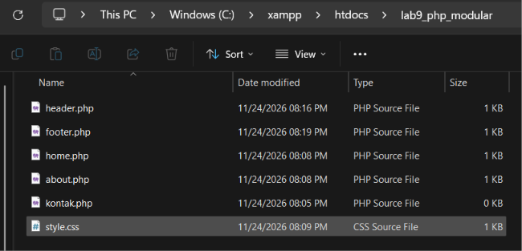

#### 1.2 Membuat `header.php`

`header.php` menyimpan bagian atas halaman: `<!DOCTYPE>`, `<head>`, pembuka `<body>`, `<div class="container">`, header judul, navigasi, dan pembuka `<main>`.

```php
<!DOCTYPE html>
<html lang="id">
<head>
    <meta charset="UTF-8">
    <meta name="viewport" content="width=device-width, initial-scale=1">
    <title>Aplikasi PHP Modular</title>
    <link rel="stylesheet" href="style.css">
</head>
<body>
<div class="container">
    <header>
    <h1>Aplikasi PHP Modular</h1>
    <p>Contoh pemisahan template dan konten</p>
    </header>
    <nav>
    <a href="home.php">Home</a>
    <a href="about.php">Tentang</a>
    <a href="kontak.php">Kontak</a>
    </nav>
    <main>
```

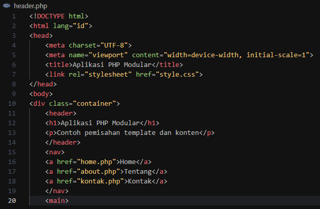

#### 1.3 Membuat `footer.php`

`footer.php` menutup `<main>`, menampilkan footer dengan tahun berjalan dari `date('Y')`, lalu menutup `</div>`, `</body>`, dan `</html>`.

```php
    </main>
    <footer>
        <p>&copy; <?php echo date('Y'); ?> - Praktikum Pemrograman Web</p>
    </footer>
</div>
</body>
</html>
```

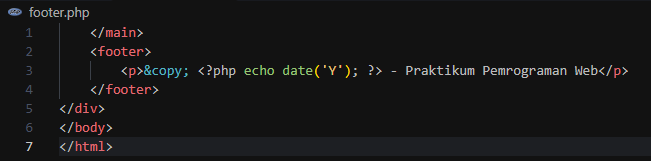

#### 1.4 Membuat halaman `home.php`

Setiap halaman hanya berisi konten uniknya, dibungkus `require_once` ke header dan footer.

```php
<?php require_once __DIR__ . '/header.php'; ?>
<section class="content">
    <h2>Halaman Home</h2>
    <p>Ini adalah konten khusus halaman beranda.</p>
</section>
<?php require_once __DIR__ . '/footer.php'; ?>
```

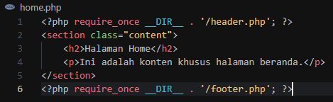

#### 1.5 Membuat halaman `about.php`

Pola yang sama dipakai `about.php`, hanya isi `<section>` yang berbeda.

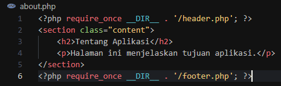

#### 1.6 Membuat `style.css`

Satu file CSS dipakai semua halaman karena hanya dimuat sekali dari `header.php`.

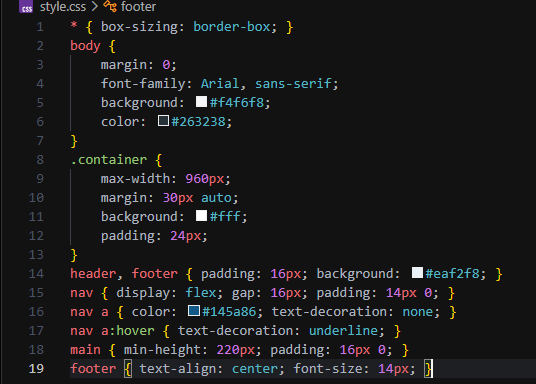

#### 1.7 Hasil di browser

Halaman `home.php` menampilkan header, navigasi, konten beranda, dan footer dengan tahun 2026.

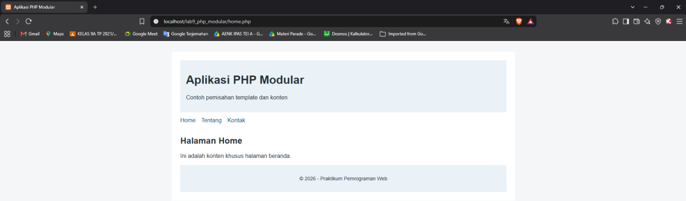

Halaman `about.php` memakai header dan footer yang sama, hanya judul dan teks kontennya berubah.

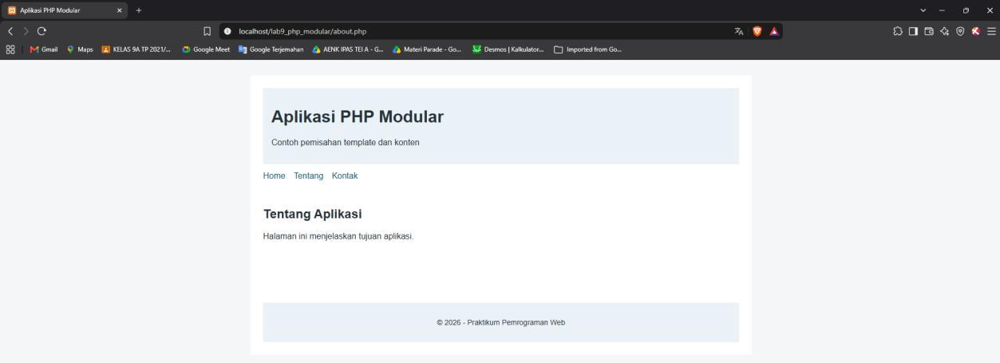

### 2. Function pada PHP

#### 2.1 Function tanpa parameter

```php
<?php
function tampilkanSalam() {
    echo "Selamat belajar PHP modular!";
}

tampilkanSalam();
?>
```

Function `tampilkanSalam()` menampilkan teks tanpa membutuhkan parameter.

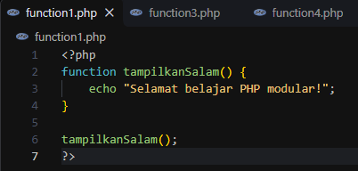

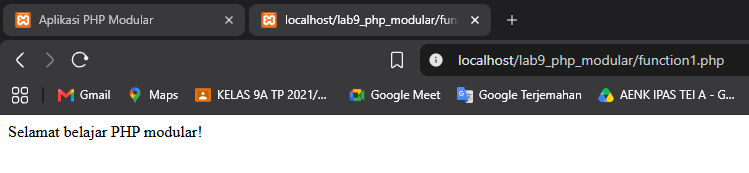

#### 2.2 Function dengan parameter

```php
<?php
function sapaPengguna($nama) {
    echo "Halo, " . htmlspecialchars($nama, ENT_QUOTES, 'UTF-8');
}

sapaPengguna("Rina");
?>
```

Function `sapaPengguna()` menerima parameter `$nama` untuk menampilkan salam sesuai nama yang diberikan.

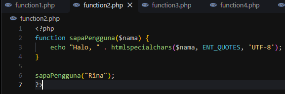

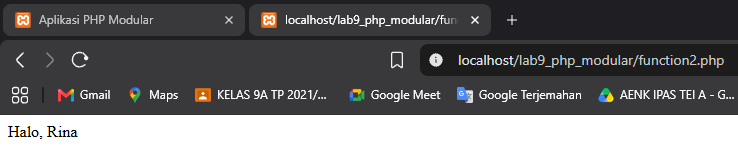

#### 2.3 Function dengan return

```php
<?php
function hitungLuasPersegiPanjang($panjang, $lebar) {
    return $panjang * $lebar;
}

$luas = hitungLuasPersegiPanjang(8, 5);
echo "Luas: " . $luas;
?>
```

Function menghitung luas persegi panjang dan mengembalikan hasilnya lewat `return`. Hasilnya disimpan di variabel `$luas`, lalu ditampilkan dengan `echo`.

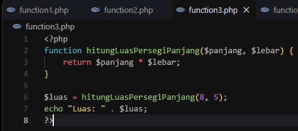

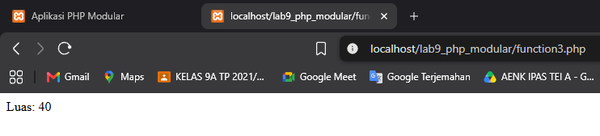

#### 2.4 Type declaration dan nilai default

```php
<?php
function hitungDiskon(float $harga, float $persen = 10): float {
    return $harga * ($persen / 100);
}

echo hitungDiskon(200000);     // diskon 10%
echo hitungDiskon(200000, 15); // diskon 15%
?>
```

Function `hitungDiskon()` memakai tipe data `float` dan nilai default diskon 10%. Kalau persentase diberikan saat pemanggilan, nilai itulah yang dipakai. Dua pemanggilan berurutan menghasilkan `20000` dan `30000`.

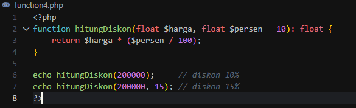

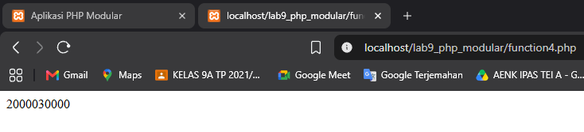

#### 2.5 Memisahkan function ke file helper

Function yang dipakai berulang dipindahkan ke `helpers.php`.

```php
<?php
function formatRupiah(float $angka): string {
    return 'Rp ' . number_format($angka, 0, ',', '.');
}

function e(string $nilai): string {
    return htmlspecialchars($nilai, ENT_QUOTES, 'UTF-8');
}
?>
```

File lain memanggilnya lewat `require_once __DIR__ . '/helpers.php'`.

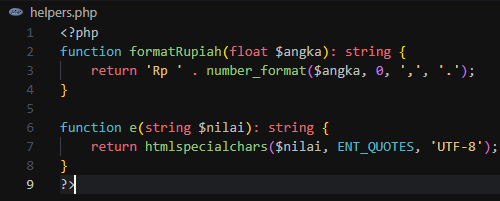

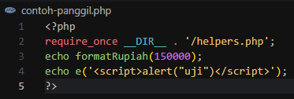

`formatRupiah()` mengubah angka menjadi format mata uang rupiah, sedangkan `e()` mencegah teks HTML atau script dijalankan browser. Hasilnya, tag `<script>` tampil sebagai teks biasa, bukan dieksekusi.

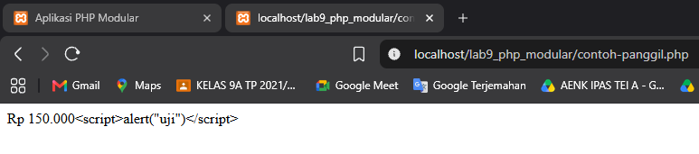

### 3. Latihan Function

Empat tugas latihan:

1. `konversiCelciusKeFahrenheit($c)` yang mengembalikan hasil konversi.
2. `tentukanStatusNilai($nilai)` yang mengembalikan predikat berdasarkan rentang nilai.
3. `hitungTotal($harga, $jumlah)` yang mengembalikan total belanja.
4. Seluruh function dipindahkan ke `helpers.php` dan dipanggil dari minimal dua halaman.

Isi `helpers.php` setelah ditambah tiga function latihan:

```php
function konversiCelciusKeFahrenheit($c) {
    return ($c * 9 / 5) + 32;
}

function tentukanStatusNilai($nilai) {
    if ($nilai >= 85) {
        return "A";
    } elseif ($nilai >= 75) {
        return "B";
    } elseif ($nilai >= 65) {
        return "C";
    } elseif ($nilai >= 50) {
        return "D";
    } else {
        return "E";
    }
}

function hitungTotal($harga, $jumlah) {
    return $harga * $jumlah;
}
```

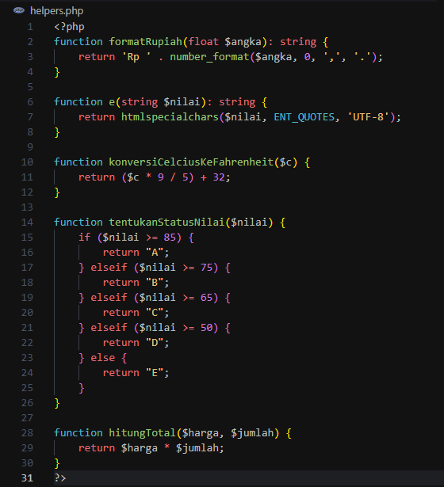

Halaman pertama menguji ketiga function dengan nilai 30, 80, dan 15000 x 3.

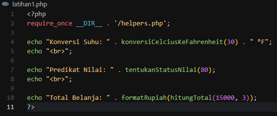

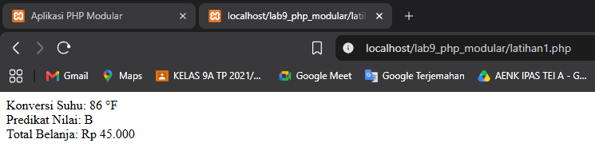

Halaman kedua memakai function yang sama dengan nilai berbeda: 100, 90, dan 25000 x 4.

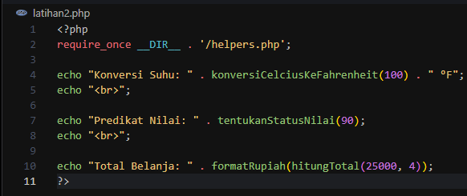

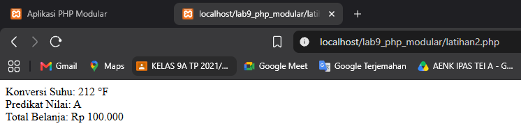

### 4. Menata Struktur Direktori Aplikasi

Folder `project/` disusun mengikuti pembagian tanggung jawab: `assets`, `config`, `helpers`, `modules`, dan `views`, dengan `index.php` sebagai pintu masuk.

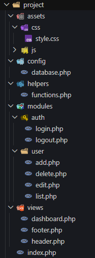

- `index.php`: titik masuk aplikasi dan pengatur pemanggilan halaman (router).
- `config/`: konfigurasi aplikasi, termasuk koneksi database.
- `views/`: komponen tampilan yang digunakan bersama.
- `helpers/`: function umum yang dapat digunakan oleh banyak modul.
- `modules/`: kumpulan fitur aplikasi yang dikelompokkan berdasarkan domain/fungsi.
- `assets/`: file statis seperti CSS, JavaScript, dan gambar.

### 5. Routing Sederhana dengan Parameter URL

Router memakai array `$routes` sebagai whitelist. Parameter `page` dari URL hanya dipakai sebagai kunci array, bukan langsung sebagai path file.

```php
<?php
require_once __DIR__ . '/helpers/functions.php';

$routes = [
    'dashboard' => __DIR__ . '/views/dashboard.php',
    'user/list' => __DIR__ . '/modules/user/list.php',
    'user/add' => __DIR__ . '/modules/user/add.php',
    'user/edit' => __DIR__ . '/modules/user/edit.php',
];

$page = $_GET['page'] ?? 'dashboard';

if (!is_string($page) || !array_key_exists($page, $routes)) {
    http_response_code(404);
    $contentFile = __DIR__ . '/views/404.php';
} else {
    $contentFile = $routes[$page];
}

require_once __DIR__ . '/views/header.php';
require $contentFile;
require_once __DIR__ . '/views/footer.php';
?>
```

Pemeriksaan `is_string($page)` menangani kasus parameter dikirim sebagai array, misalnya `page[]=dashboard`, karena `array_key_exists()` akan error kalau kuncinya bukan string.

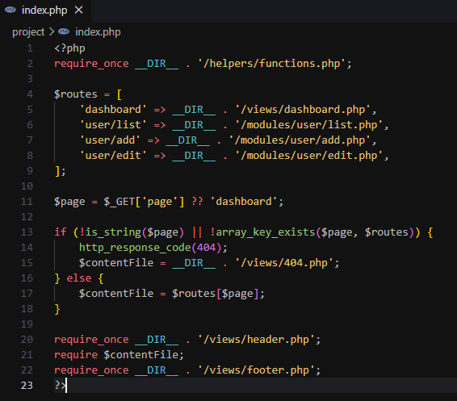

Contoh file modul, `modules/user/list.php`:

```php
<section>
    <h2>Data Pengguna</h2>
    <p>Daftar pengguna ditampilkan pada bagian ini.</p>
    <a href="index.php?page=user/add">Tambah Pengguna</a>
</section>
```

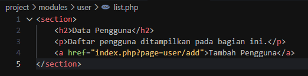

`modules/user/add.php` berisi form tambah pengguna:

```php
<section>
    <h2>Tambah Pengguna</h2>
    <form method="post" action="">
        <label>Nama</label>
        <input type="text" name="nama" required>
        <button type="submit">Simpan</button>
    </form>
</section>
```

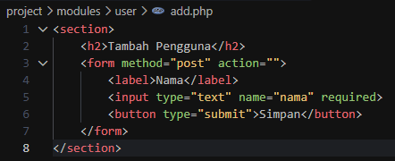

### 6. Menambahkan Halaman 404 dan Menguji Routing

`views/404.php` dipakai saat rute tidak ditemukan, dan router mengirim `http_response_code(404)` sebelum memuatnya.

```php
<section>
    <h2>404 - Halaman tidak ditemukan</h2>
    <p>Halaman yang diminta tidak tersedia.</p>
    <a href="index.php">Kembali ke dashboard</a>
</section>
```

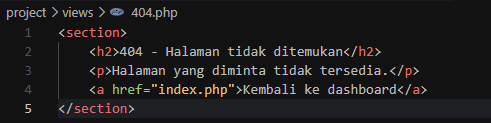

Pengujian routing:

1. `http://localhost/lab9_php_modular/project/index.php` menampilkan dashboard.

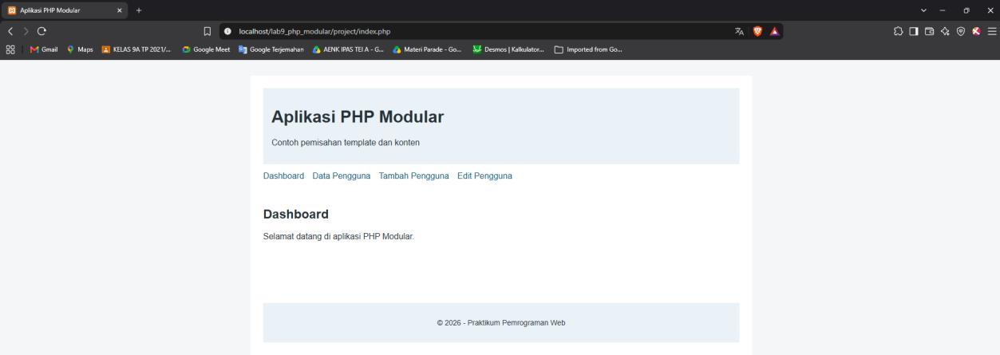

2. `index.php?page=user/list` menampilkan modul daftar pengguna.

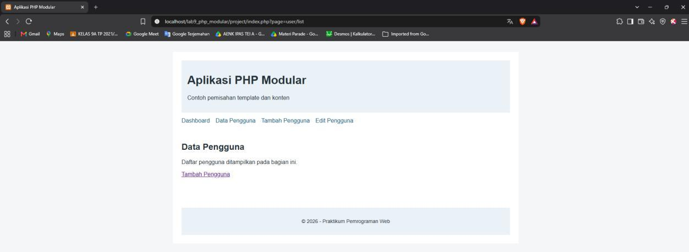

3. `index.php?page=user/add` menampilkan form tambah pengguna.

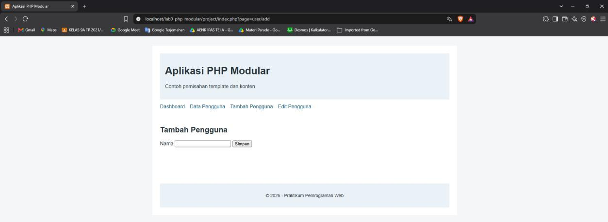

4. `index.php?page=admin/rahasia` menampilkan halaman 404 karena rute tidak terdaftar.

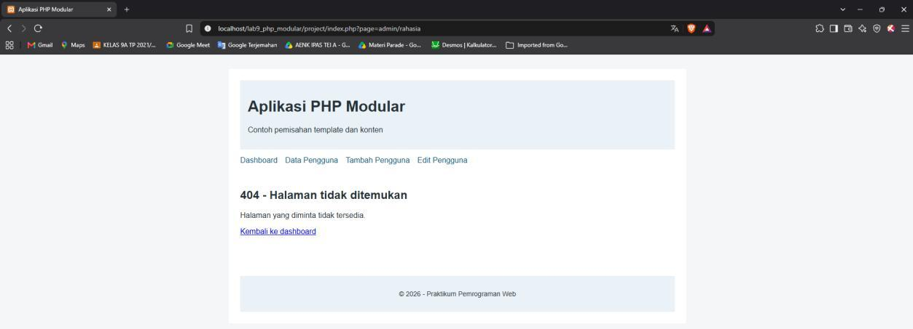

5. Parameter kosong (`index.php?page=`) tetap ditangani aman dan menampilkan 404.

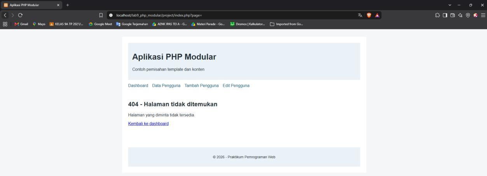

6. Parameter yang tidak sesuai tipe (`index.php?page[]=dashboard`) juga ditolak dengan 404, bukan error PHP.

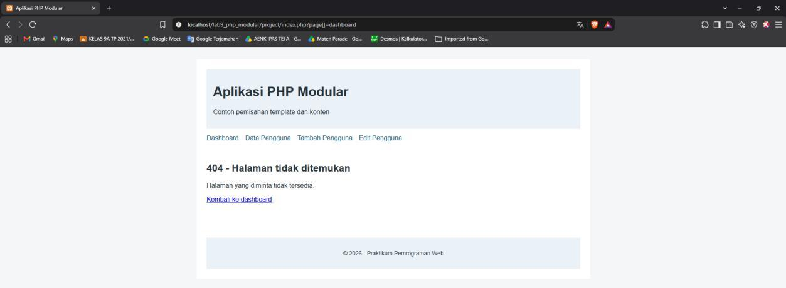

### 7. Integrasi dengan Aplikasi Database Praktikum Sebelumnya

#### 7.1 Menyalin project CRUD

Project CRUD dari praktikum sebelumnya disalin menjadi `lab9_crud_modular/`, sehingga salinan aslinya tetap utuh.

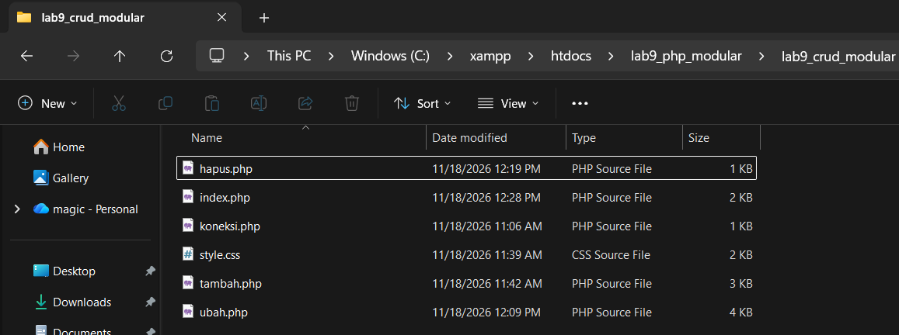

#### 7.2 Membuat direktori modular

Direktori `config`, `views`, `helpers`, dan `modules` dibuat di dalam `lab9_crud_modular/`. Folder `assets` tidak dipakai di project ini karena CSS diletakkan langsung di root.

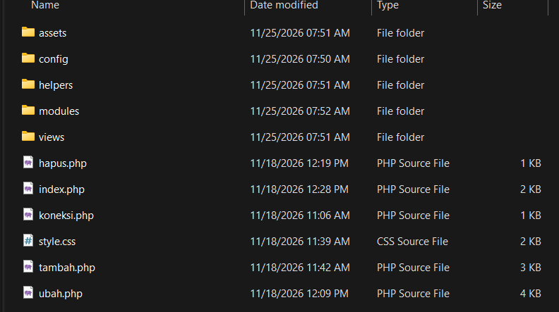

#### 7.3 Memindahkan koneksi database ke `config/database.php`

```php
<?php
$host = "localhost";
$user = "root";
$pass = "";
$db = "latihan1";
$conn = mysqli_connect($host, $user, $pass, $db);
if ($conn == false)
{
    echo "Koneksi ke server gagal.";
    die();
}else echo "Koneksi berhasil";
?>
```

File ini dimuat dengan `require_once`, misalnya di `modules/barang/list.php` dan `modules/barang/delete.php`.

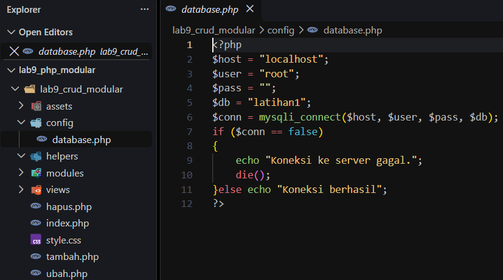

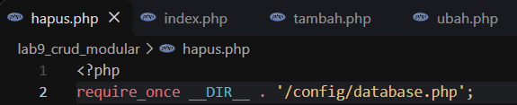

#### 7.4 Memindahkan header, navigasi, dan footer ke `views/`

`views/header.php` membuka dokumen HTML dan memuat `style.css`, `views/footer.php` menutupnya.

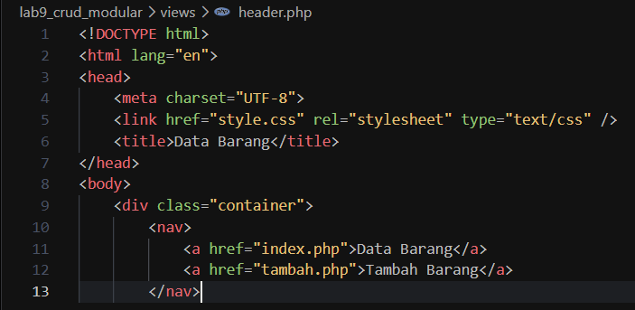

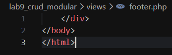

#### 7.5 Memindahkan function umum ke `helpers/functions.php`

Function `is_select()` dipindahkan ke helper agar bisa dipakai ulang tanpa menulis ulang kode.

```php
<?php
function is_select($var, $val) {
    if ($var == $val) return 'selected="selected"';
    return false;
}
?>
```

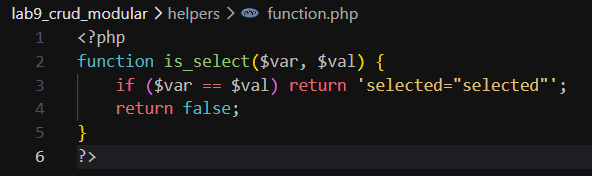

Pemanggilannya di `modules/barang/edit.php`:

```php
<?php
error_reporting(E_ALL);
require_once __DIR__ . '/../../config/database.php';
require_once __DIR__ . '/../../helpers/functions.php';
```

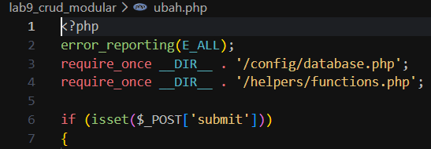

#### 7.6 Mengelompokkan halaman CRUD ke `modules/barang/`

Keempat halaman CRUD dikelompokkan dalam satu folder modul.

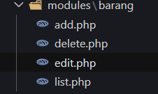

#### 7.7 Membuat `index.php` sebagai router

```php
<?php
ob_start();

require_once __DIR__ . '/config/database.php';
require_once __DIR__ . '/helpers/functions.php';

$routes = [
    'barang/list' => __DIR__ . '/modules/barang/list.php',
    'barang/add' => __DIR__ . '/modules/barang/add.php',
    'barang/edit' => __DIR__ . '/modules/barang/edit.php',
    'barang/delete' => __DIR__ . '/modules/barang/delete.php',
];

$page = $_GET['page'] ?? 'barang/list';

if (!is_string($page) || !array_key_exists($page, $routes)) {
    http_response_code(404);
    $contentFile = __DIR__ . '/views/404.php';
} else {
    $contentFile = $routes[$page];
}

require_once __DIR__ . '/views/header.php';
require $contentFile;
require_once __DIR__ . '/views/footer.php';

ob_end_flush();
?>
```

`ob_start()` dan `ob_end_flush()` menahan output supaya `header('location: ...')` di modul add, edit, dan delete tetap bisa dijalankan tanpa peringatan "headers already sent".

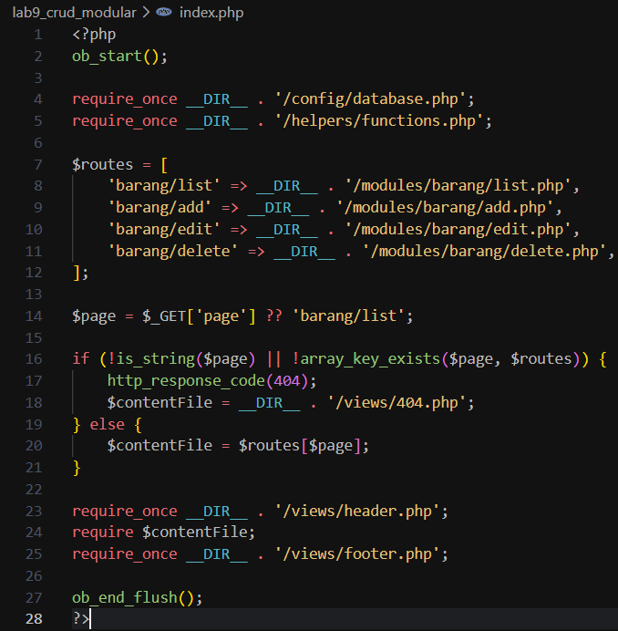

#### 7.8 Mengubah tautan navigasi dan tautan aksi

Navigasi di `views/header.php` memakai pola `index.php?page=...`:

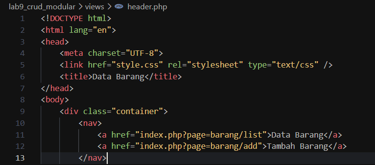

Tautan aksi di `modules/barang/list.php` juga memakai pola yang sama. Hapus diubah menjadi form POST agar proses delete tidak terpicu oleh tautan biasa.

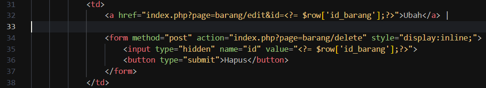

Form tambah mengarah ke `index.php?page=barang/add`:

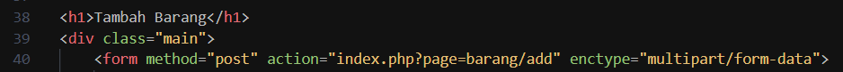

Form ubah mengarah ke `index.php?page=barang/edit&id=...`:

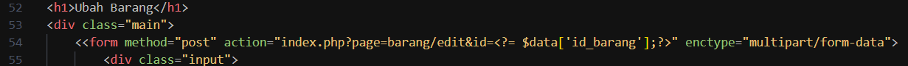

#### 7.9 Menguji setiap fitur CRUD

Read (menampilkan data barang):

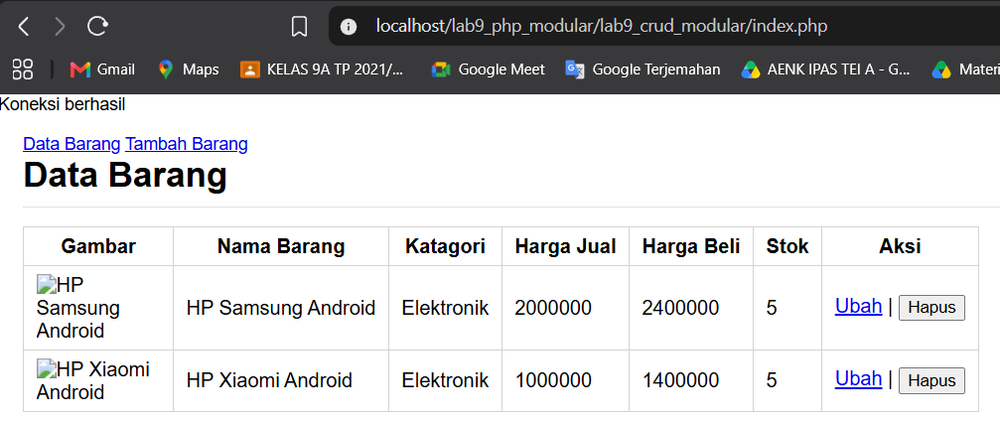

Create (menambah data barang):


Update (mengubah data barang):


Delete (menghapus data barang):

Data "mos werles" dihapus lewat tombol Hapus, lalu tabel kembali berisi dua baris.


Catatan hasil pengujian:

- Kolom Gambar menampilkan ikon gambar rusak karena file gambar belum ada di folder `gambar/`, sedangkan nama filenya sudah tercatat di database.
- Pada form ubah muncul karakter `<` di atas label pertama. Penyebabnya typo `<<form` pada `modules/barang/edit.php`, yang membuat browser membaca satu `<` sebagai teks.
- Kolom Harga Jual dan Harga Beli tampil tertukar karena `modules/barang/list.php` mencetak `harga_beli` di kolom Harga Jual dan sebaliknya.

---

## Analisis Hasil

### 1. Bagian mana yang digunakan bersama oleh semua halaman?

Ada tiga komponen yang dipakai ulang:

| File | Isi | Dipanggil lewat |
| --- | --- | --- |
| `header.php` | `<!DOCTYPE>`, `<html>`, `<head>` (charset, viewport, title, link `style.css`), `<body>`, `<div class="container">`, `<header>` (judul + subjudul), `<nav>` (Home, Tentang, Kontak), pembuka `<main>` | `require_once __DIR__ . '/header.php'` |
| `footer.php` | `</main>`, `<footer>` dengan `© <?php echo date('Y'); ?>`, `</div>`, `</body>`, `</html>` | `require_once __DIR__ . '/footer.php'` |
| `style.css` | Seluruh styling (container, header/footer, nav, main) | Satu `<link>` di `header.php` |

Pola tiap halaman: header, lalu konten unik di `<section class="content">`, lalu footer. Yang berubah hanya bagian tengah.

### 2. Apa yang terjadi jika teks navigasi diubah pada `header.php`?

Semua halaman ikut berubah sekaligus. Tiap halaman tidak menyimpan salinan navigasi, tetapi memuat file yang sama saat dijalankan. Contohnya, tautan `Kontak` diganti menjadi `Hubungi Kami` pada `header.php`, maka Home dan Tentang langsung menampilkan teks baru tanpa disentuh satu per satu.

Sisi lainnya: satu salah ketik di sini juga langsung merusak navigasi seluruh situs, jadi `header.php` perlu diperlakukan sebagai file inti, bukan file percobaan.

### 3. Mengapa konten halaman tidak diletakkan seluruhnya di `header.php`?

Karena `header.php` adalah template layout, bukan halaman. Kalau semua konten ditaruh di sana:

- Semua halaman jadi identik, `home.php` dan `about.php` menampilkan isi yang sama persis.
- Tujuan modularisasi hilang. Inti praktikum ini memisahkan layout yang berulang dari konten yang unik per halaman.
- Konten jadi tidak fleksibel, tiap halaman butuh judul dan teks sendiri.
- Perawatan lebih rawan, mengubah tampilan header berarti mengutak-atik file yang juga berisi konten.

### 4. Manfaat `require_once` dibanding menyalin kode header ke setiap halaman?

- **Satu sumber kebenaran.** Header dan footer ditulis sekali, bukan diulang di setiap file.
- **Konsisten.** Tidak mungkin ada halaman yang headernya ketinggalan versi.
- **`_once` mencegah pemuatan ganda.** Kalau `header.php` ter-include dua kali, PHP tidak mengeksekusinya ulang, jadi deklarasi function atau class tidak bentrok dan HTML tidak terkirim dobel.
- **`require` bersifat wajib.** File hilang berarti error fatal yang jelas, bukan halaman setengah rusak seperti pada `include`.
- **`__DIR__` menghasilkan path absolut**, jadi tetap benar walau file dipanggil dari lokasi berbeda.
- **File halaman jadi lebih pendek** dan fokus ke kontennya.

---

## Pertanyaan Pemahaman

### 1. Jelaskan pengertian modularisasi program dan minimal tiga manfaatnya.

Modularisasi program adalah teknik membagi program menjadi beberapa bagian kecil berdasarkan fungsi dan tanggung jawabnya masing-masing. Manfaatnya antara lain:

- Mengurangi pengulangan kode.
- Mempermudah perbaikan dan pemeliharaan program.
- Mempermudah pengembangan aplikasi.
- Membuat struktur kode lebih rapi dan mudah dipahami.

### 2. Apa perbedaan `include` dan `require` ketika file yang dipanggil tidak ditemukan?

`include` menghasilkan pesan peringatan, tetapi program tetap berjalan. `require` menghasilkan error yang menyebabkan eksekusi program berhenti.

### 3. Mengapa `require_once` sesuai digunakan untuk memuat konfigurasi database?

Karena `require_once` memastikan file konfigurasi database wajib tersedia dan hanya dimuat satu kali selama eksekusi program. Hal ini mencegah pemanggilan file dan deklarasi kode secara berulang.

### 4. Jelaskan perbedaan parameter, argumen, dan nilai return pada function.

Parameter adalah variabel yang ditentukan saat function dibuat. Argumen adalah nilai yang diberikan ketika function dipanggil. Nilai return adalah nilai yang dikembalikan function untuk digunakan kembali dalam program.

### 5. Mengapa header dan footer sebaiknya dipisahkan dari konten halaman?

Agar header dan footer dapat digunakan kembali pada beberapa halaman tanpa menulis ulang kode. Jika ada perubahan tampilan atau navigasi, cukup mengubah file template sehingga seluruh halaman yang menggunakannya ikut berubah.

### 6. Apa fungsi `index.php` pada pola routing yang dipraktikkan?

`index.php` adalah pintu masuk utama aplikasi yang menentukan halaman mana yang ditampilkan berdasarkan parameter `page` pada URL.

### 7. Mengapa router sebaiknya menggunakan whitelist rute?

Whitelist membatasi halaman yang boleh diakses pada daftar rute yang sudah ditulis di `$routes`. Parameter `page` hanya dipakai sebagai kunci array, bukan dirangkai menjadi path file, sehingga permintaan di luar daftar otomatis ditolak dan diarahkan ke halaman 404.

### 8. Apa risiko jika input `page` langsung digabungkan menjadi path file yang di-`require`?

Pengguna dapat memanipulasi parameter `page` pada URL untuk mengakses file yang tidak seharusnya dipanggil. Hal ini dapat menyebabkan celah keamanan seperti path traversal, kebocoran informasi, dan pemanggilan file yang tidak diizinkan.

### 9. Apa fungsi aturan `RewriteCond` dan `RewriteRule` pada `.htaccess`?

`RewriteCond` menentukan kondisi yang harus dipenuhi sebelum aturan pengubahan URL dijalankan. `RewriteRule` mengatur bagaimana URL diubah atau diteruskan ke router utama. Keduanya dipakai agar URL lebih ringkas dan mudah dibaca.

### 10. Sebutkan bagian aplikasi CRUD yang paling tepat dipindahkan ke `config`, `views`, `helpers`, dan `modules`.

- `config/`: konfigurasi aplikasi dan koneksi database.
- `views/`: komponen tampilan seperti header, footer, dan halaman dashboard.
- `helpers/`: function yang dapat digunakan kembali, seperti validasi input dan format tampilan.
- `modules/`: fitur CRUD, yaitu menampilkan, menambah, mengubah, dan menghapus data.

---

## Kesimpulan

Praktikum 9 memindahkan aplikasi CRUD dari kode yang tersebar di banyak file menjadi aplikasi modular. Layout yang dipakai bersama masuk ke `views/`, koneksi database ke `config/`, function umum ke `helpers/`, fitur CRUD ke `modules/barang/`, dan seluruh akses halaman melewati satu router di `index.php`.

Router dengan whitelist membuat alamat halaman seragam (`index.php?page=barang/list`), sekaligus menutup akses ke file yang tidak terdaftar lewat halaman 404. Pemeriksaan `is_string($page)` dan `array_key_exists()` menangani parameter kosong, rute asing, maupun parameter bertipe array tanpa error PHP.

Dari sisi tampilan, aplikasi masih memakai tabel dan form HTML dasar. Pengembangan berikutnya bisa diarahkan ke validasi input, query prepared statement, penanganan upload gambar yang lebih lengkap, serta perbaikan pemetaan kolom harga di halaman daftar barang.
